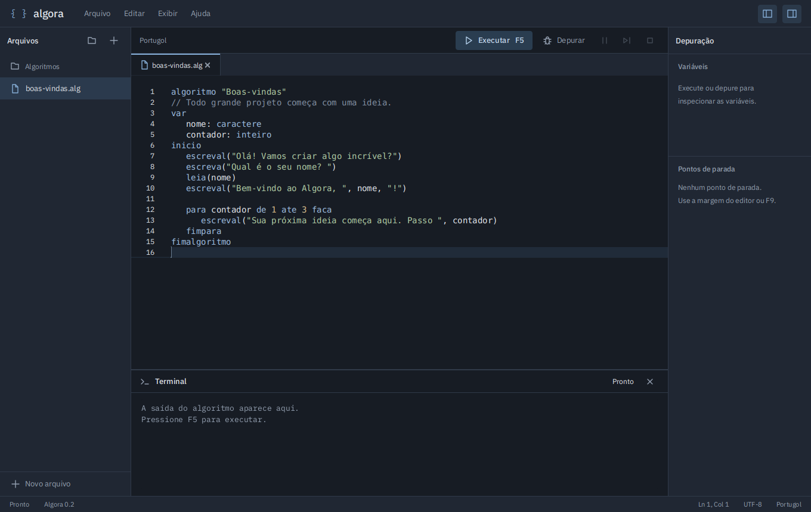

# Algora

<p align="center">
  
</p>

IDE para escrever, executar e depurar algoritmos em Portugol, com interpretador próprio para arquivos `.alg` do dialeto VisualG. O projeto usa **Java 21, JavaFX 21, ANTLR4 e RichTextFX**, com **Gradle Kotlin DSL**, testes **JUnit 5** e distribuição nativa via **jpackage**.

A interface reúne editor com abas e realce de sintaxe, entrada e saída do algoritmo, autocompletar e depurador com pontos de parada e inspeção de variáveis. O núcleo da linguagem permanece independente da interface gráfica. A compatibilidade é parcial: o [levantamento Java](interpreter/compatibility-survey.md) aceitou 58 de 73 arquivos do conjunto local pelo parser, sem afirmar equivalência integral de execução. Consulte a [matriz de compatibilidade](docs/compatibilidade.md) antes de importar programas existentes.



A interface utiliza fontes IBM Plex locais, painéis recolhíveis e composição adaptada a janelas compactas. Os 23 testes e a execução dos aplicativos empacotados passaram em Linux e Windows. Veja a [direção visual](docs/design-interface.md), a [visualização compacta](docs/assets/algora-compacto.png) e o [registro de verificação](docs/verificacao.md).

## Download e instalação

Baixe os instaladores na [release v0.2.0](https://github.com/thurdass/Algora/releases/tag/v0.2.0):

- **Windows x64:** execute `Algora-0.2.0.exe` e siga o instalador.
- **Linux x64 (Debian/Ubuntu):** baixe `algora_0.2.0_amd64.deb` e execute `sudo apt install ./algora_0.2.0_amd64.deb`.

Os instaladores incluem o runtime Java; não é necessário instalar um JDK para usar a IDE. O arquivo `SHA256SUMS.txt` permite conferir a integridade dos downloads. O pacote Linux é destinado a distribuições compatíveis com `.deb`.

## Executar a partir do código

Instale um JDK 21 completo. O Gradle Wrapper baixa as dependências na primeira execução.

```sh
./gradlew test
./gradlew :desktop:run
./gradlew :cli:run --args='examples/ola.alg'
```

No Windows, substitua `./gradlew` por `.\gradlew.bat`. Os exemplos originais em `examples/` incluem entrada de dados, fatorial e vetores. O terminal integrado recebe valores de `leia` e apresenta a saída; não é um shell do sistema operacional.

## Usar a IDE

| Atalho | Ação |
| --- | --- |
| `Ctrl+N`, `Ctrl+O`, `Ctrl+S` | Novo arquivo, abrir e salvar |
| `Ctrl+Espaço` | Sugestões de palavras e modelos de estruturas |
| `Ctrl+B` | Mostrar ou ocultar arquivos |
| `Ctrl+Shift+D` | Mostrar ou ocultar depuração |
| `F5` | Executar ou continuar |
| `F9` | Alternar ponto de parada na linha atual |
| `F10` | Avançar uma instrução |

Também é possível marcar pontos de parada na margem esquerda do editor. Os controles permitem iniciar depuração, pausar e interromper. A abertura tenta UTF-8 e usa Windows-1252 para arquivos legados; o salvamento escreve UTF-8.

## Gerar distribuição

```sh
./gradlew :desktop:jpackageAppImage
./gradlew :desktop:jpackageInstaller
```

`jpackageAppImage` gera uma pasta de aplicação com runtime Java incluído, correspondente ao tipo `app-image` do JDK. Não gera um arquivo Linux `.AppImage`. `jpackageInstaller` gera o instalador nativo do sistema onde o build é executado. Linux e Windows exigem builds e validação próprios. Veja [instalação](docs/instalacao.md) para requisitos e limitações.

## Organização

- `interpreter`: gramática ANTLR4, AST, execução e API de depuração, sem dependência gráfica.
- `desktop`: aplicação JavaFX 21 e editor RichTextFX.
- `cli`: execução de algoritmos no terminal usando o mesmo interpretador.
- `examples`: programas originais para experimentar.
- `docs`: arquitetura, API, compatibilidade e evidências da investigação.

Consulte a [arquitetura](docs/arquitetura.md), a [API Java](docs/api.md) e o [relatório REA](docs/engenharia-reversa.md). O Algora foi implementado de forma independente. O executável, recursos e código proprietário do VisualG não são distribuídos. A análise estática do original não comprova equivalência integral de comportamento.

Repositório: [thurdass/Algora](https://github.com/thurdass/Algora), privado. Os commits seguem Conventional Commits.

### Aparência

Escolha entre seis temas em **Exibir → Tema de cores**: Grafite, Dracula, Nord, Solarizado escuro, Claro e Solarizado claro. A preferência é salva automaticamente. O layout segue as referências do IntelliJ e VS Code, com barras compactas e atalhos laterais para os painéis. Consulte [o guia visual](docs/design-interface.md).
