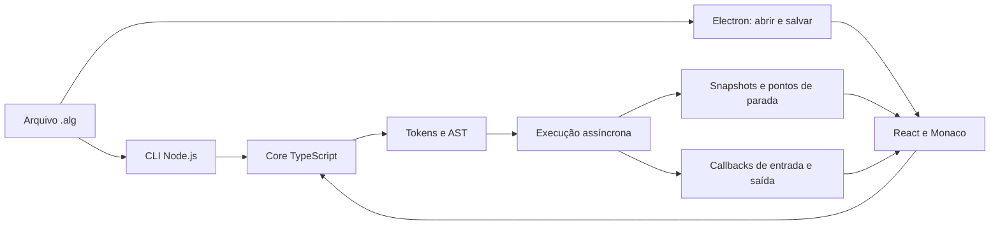

# Arquitetura

O Algora separa linguagem, apresentação e acesso ao sistema. `@algora/core` interpreta texto e expõe eventos de execução; não importa React, Monaco, Electron ou APIs de arquivos. A CLI e a IDE adaptam a entrada e a saída para esse mesmo núcleo.

O parser produz uma árvore com declarações, rotinas e instruções. O runtime mantém escopos e valores, valida tipos e índices e executa essa árvore. `leia` aguarda um callback assíncrono; a interface pode receber valores sem bloquear o processo. Os checkpoints fornecem linha e variáveis antes da instrução pausada. O passo entra nas instruções das rotinas; não há implementação de passo sobre ou saída de função.

O runtime tem limites configuráveis de instruções e profundidade de chamadas, e cede o controle periodicamente durante laços. Esses limites ajudam a manter a aplicação responsiva; não constituem uma sandbox para executar JavaScript arbitrário. O código `.alg` é interpretado e não utiliza `eval`.

O renderer usa Monaco empacotado localmente, sem depender de CDN para carregar o editor. O preload do Electron expõe operações restritas de abrir e salvar arquivos, enquanto o processo principal administra os diálogos nativos. No navegador, a interface adapta abertura e download aos recursos disponíveis.

Linux e Windows compartilham o núcleo e a interface. Electron fornece a camada desktop e electron-builder configura os formatos de distribuição. As verificações de tipos, testes e compilação devem rodar em ambos os sistemas na CI; testes manuais de diálogos, teclado, renderização e instaladores continuam necessários em cada plataforma.
