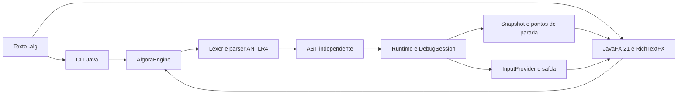

# Arquitetura

O Algora possui três módulos Java 21: `interpreter`, `desktop` e `cli`. O Gradle Kotlin DSL coordena compilação, geração do parser, testes JUnit 5 e empacotamento. A interface e a CLI dependem do núcleo; o núcleo não importa JavaFX ou RichTextFX.

A gramática ANTLR4 define tokens e estrutura sintática. O parser é gerado durante o build e convertido para uma representação de programa independente da árvore ANTLR. O runtime percorre instruções, administra variáveis e rotinas e emite snapshots nos checkpoints de execução. A extensão `.alg` não escolhe uma gramática automaticamente: o conteúdo deve pertencer ao subconjunto aceito do dialeto VisualG.

`AlgoraEngine` oferece parsing, execução direta e criação de sessões de depuração. A sessão recebe provedores de entrada, saída e observação, permitindo adaptar a linguagem ao terminal ou à interface sem incluir dependências gráficas no núcleo. A execução da interface deve ocorrer fora da thread JavaFX; atualizações visuais retornam à thread gráfica com os mecanismos do JavaFX.

O editor RichTextFX é responsável pela edição e apresentação de código; a interface implementa realce de sintaxe e sugestões usando a linguagem do Algora. O terminal integrado adapta `leia`, `escreva` e `escreval`. Ele não executa comandos do sistema.

O JDK fornece `jpackage` para distribuir uma aplicação com runtime. Bibliotecas JavaFX nativas e instaladores são específicos de cada plataforma. Compilação e testes unitários são necessários em Linux e Windows; testes de instalação e interação gráfica também devem acontecer nos dois sistemas. O suporte de build não implica que todos os instaladores já tenham sido executados em ambos.

## Organização interna do desktop

`AlgoraApplication` inicializa e conecta os componentes. `documents` administra documentos e arquivos; `editor` contém realce e sugestões; `terminal` concentra entrada e saída; `debug` apresenta variáveis e pontos de parada; `execution` coordena a sessão e os controles; `ui` compõe cabeçalho, painéis e barra de estado; `ui.components` mantém as fábricas de controles e ícones; `verification` contém a verificação empacotada existente.

As ligações de eventos entre documentos e execução são fornecidas pela inicialização por callbacks Java, sem dependências circulares entre pacotes. O interpretador permanece independente e inalterado. Veja [a refatoração estrutural](refatoracao-estrutural.md) para a árvore completa, responsabilidades, linhas antes/depois, commits e validação incremental.
